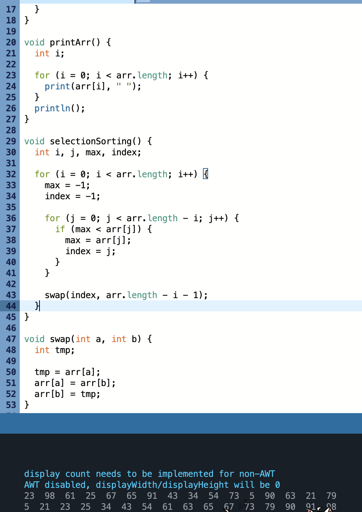
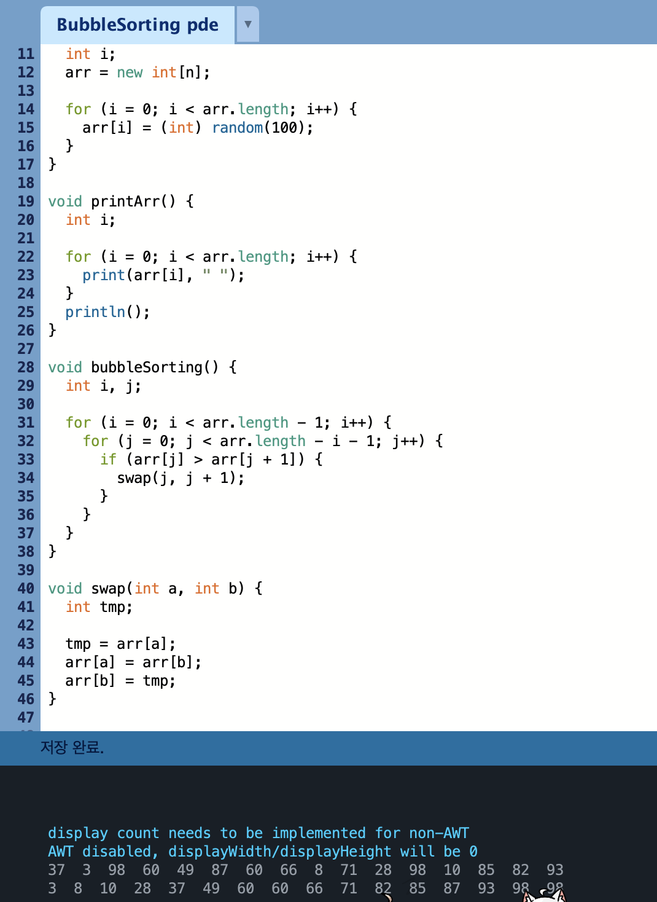
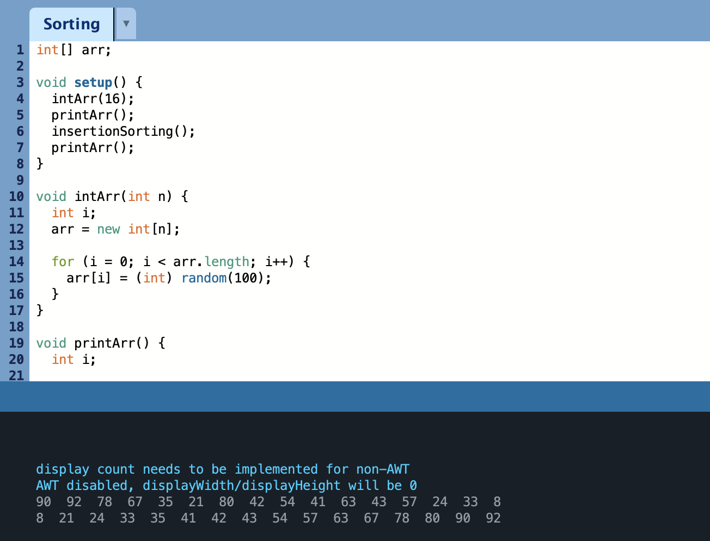
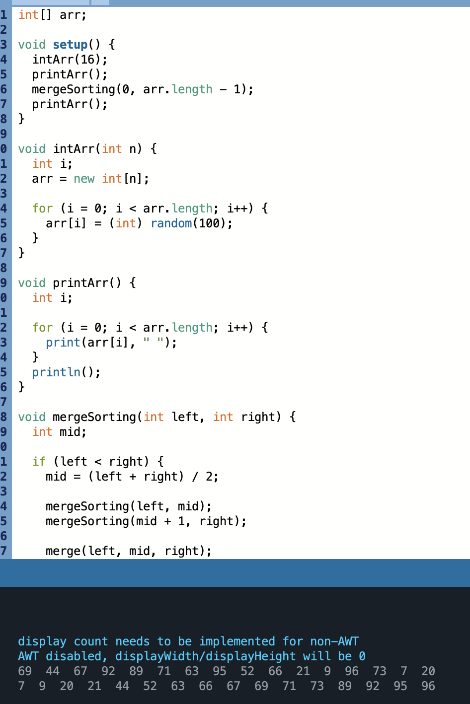
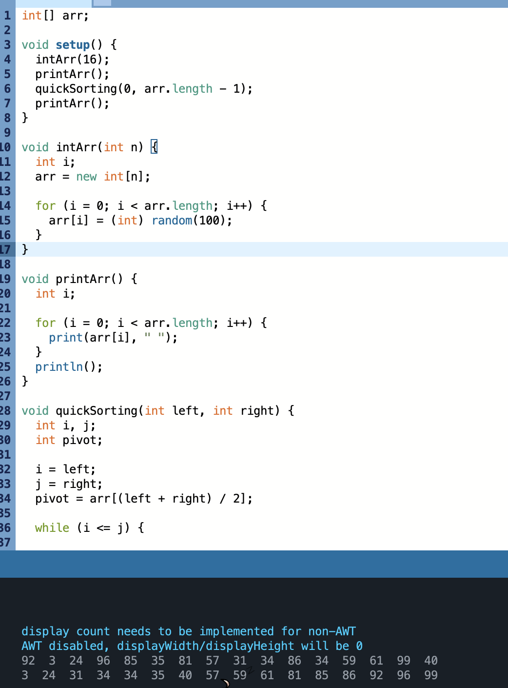
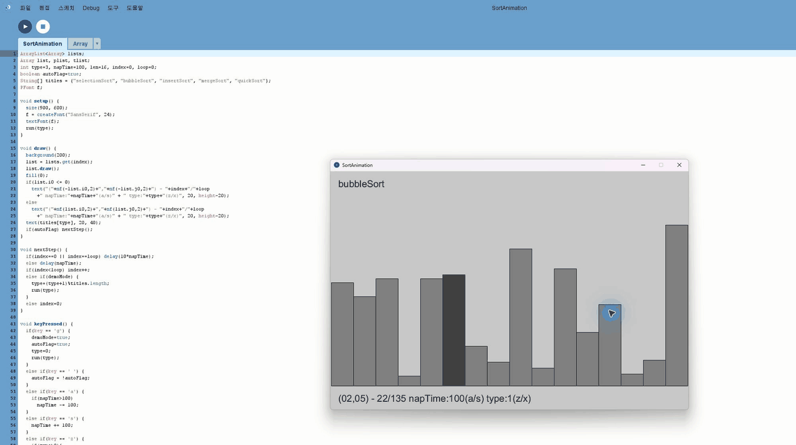
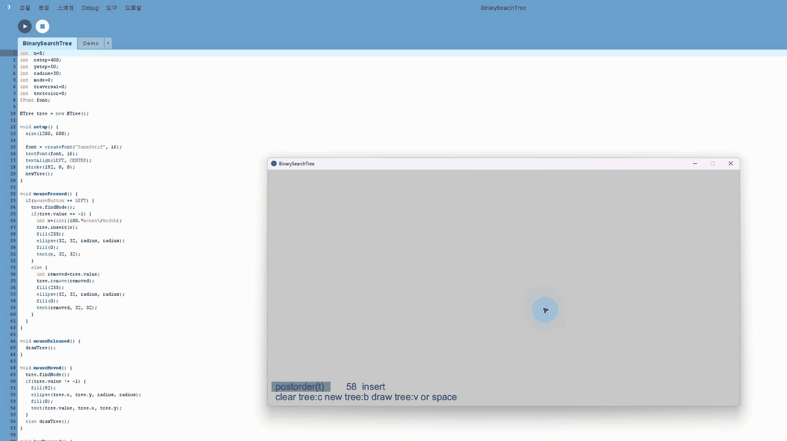
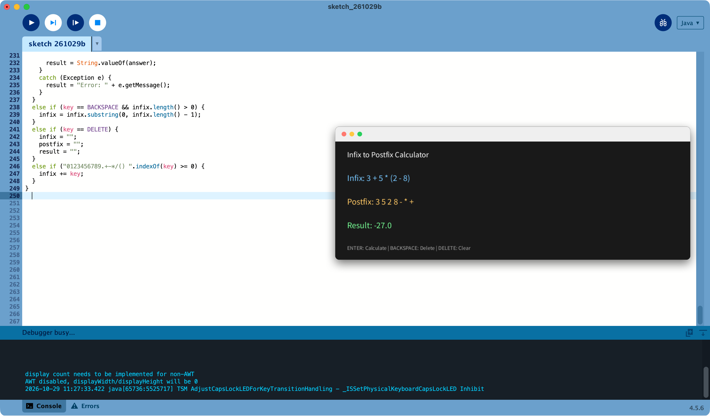
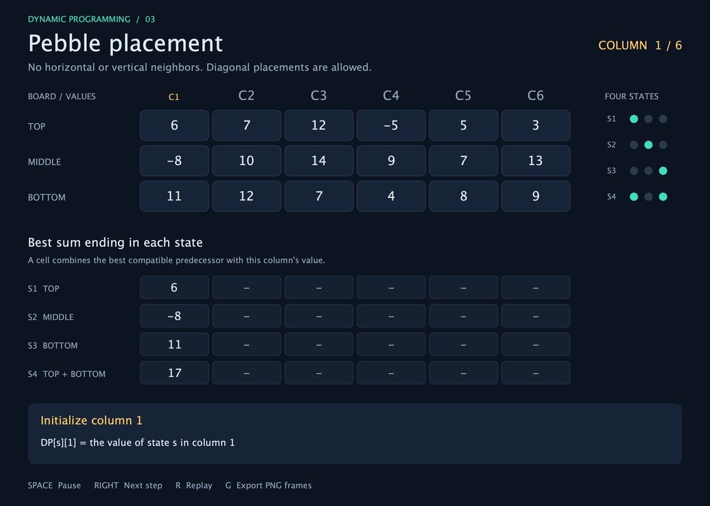

[SelectionSorting](https://github.com/YoonGun24/Algorithm/blob/main/Homework/SelectionSorting.pde)

[BubbleSorting](https://github.com/YoonGun24/Algorithm/blob/main/Homework/BubbleSorting.pde)

[InsertSorting](https://github.com/YoonGun24/Algorithm/blob/main/Homework/InsertSorting.pde)

[MergeSorting](https://github.com/YoonGun24/Algorithm/blob/main/Homework/MergeSorting.pde)

[QuickSorting](https://github.com/YoonGun24/Algorithm/blob/main/Homework/QuickSorting.pde)

[HeapSorting](https://github.com/YoonGun24/Algorithm/blob/main/Homework/HeapSorting.pde)

[SortAnimation](https://github.com/YoonGun24/Algorithm/blob/main/Homework/SortAnimation/SortAnimation.pde)

[BinarySearchTree](https://github.com/YoonGun24/Algorithm/blob/main/Homework/BinarySearchTree/BinarySearchTree.pde)

[InfixToPostfix](https://github.com/YoonGun24/Algorithm/blob/main/Homework/InfixToPostfix.pde)

[PebbleDP — 조약돌 놓기 (Processing)](https://github.com/YoonGun24/Algorithm/blob/main/Homework/PebbleDP/PebbleDP.pde)

3행 보드의 네 가지 배치 상태를 이용한 DP 계산 과정과 최적 배치를 보여 줍니다. 예제 최대합: **81**.

